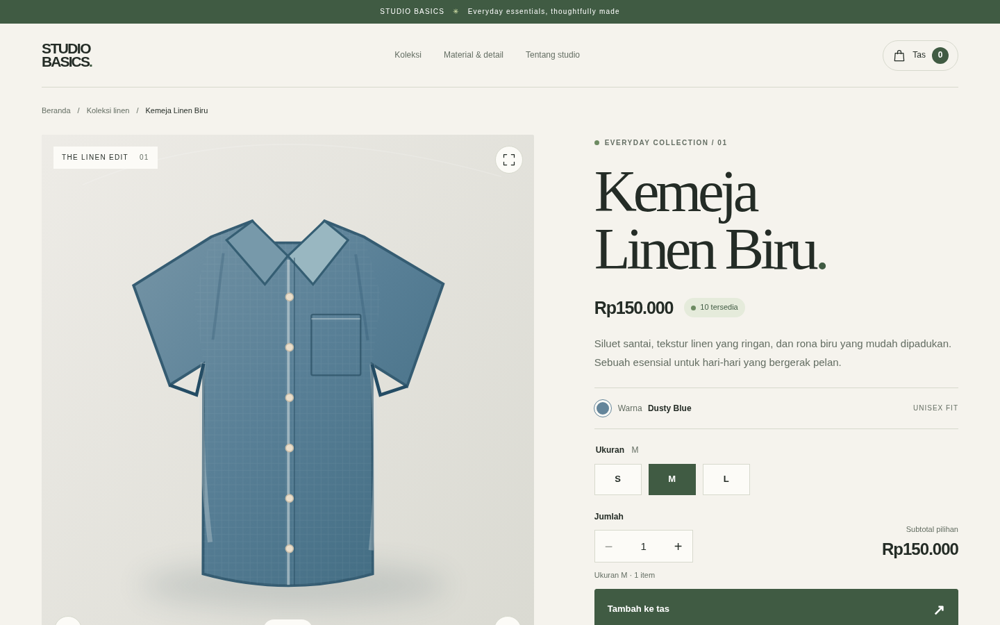
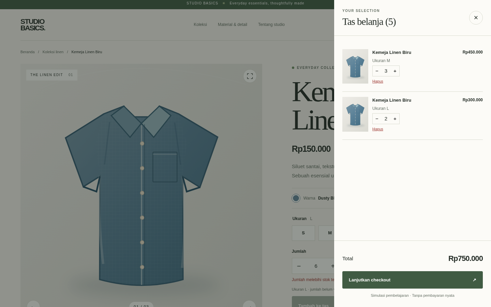
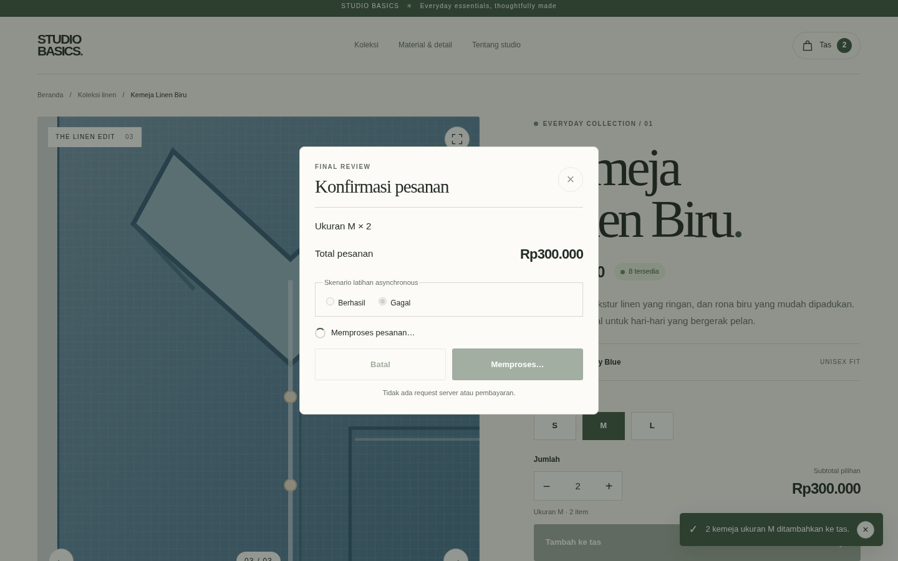
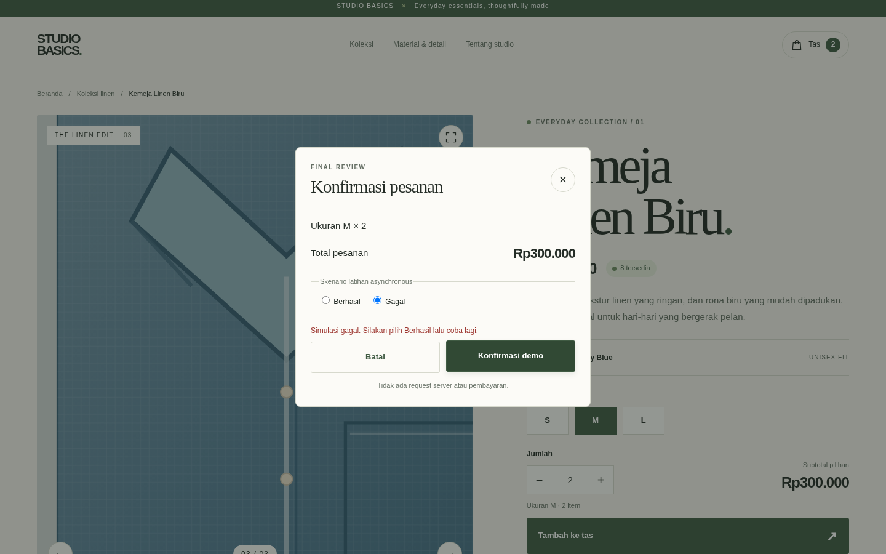
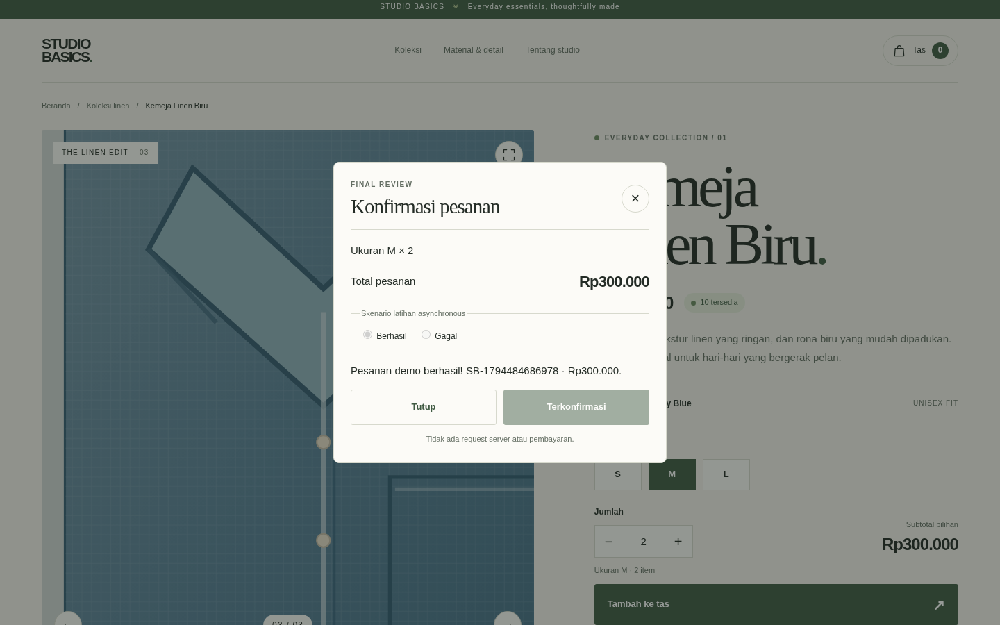
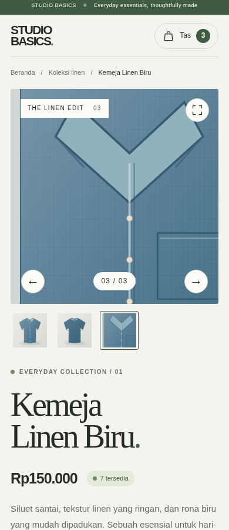

# Hasil pengujian Day 22

**Finalisasi: 12 November 2026 — 31/31 skenario PASS (26 regresi + 5 tambahan).**

Pengujian ulang terhadap source versi final setelah code cleanup dan refactoring, menggunakan Chromium 144.0.7559.96 / Playwright. HTML, CSS, JavaScript dan SVG disematkan di browser karena lingkungan review memblokir navigasi `file://`. Isi script tidak diubah; URL aset diganti data URI hanya pada harness pengujian. Desktop 1440 px dan mobile 390 px. Kelima JS lulus `node --check` dengan Node.js v22.16.0. Tidak ada page error atau request fetch/XHR pada alur pengujian.

Tabel berikut berisi hasil aktual otomatis pada lingkungan review, bukan klaim pengujian manual peserta. Buka website melalui Live Server atau file lokal di komputer sendiri untuk memverifikasi ulang. Skenario API asli tidak berlaku pada scope hardcoded ini; checkout async hanya simulasi.

| ID | Input / kondisi | Expected result | Actual result | Bukti |
|---|---|---|---|---|
| T01 | Buka index.html | Produk, harga Rp150.000, 3 thumbnail, ukuran M, stok 10, qty 1 tampil | **PASS** — Harga, stok, ukuran awal, qty dan tiga thumbnail sesuai; SVG termuat. | [01-desktop.png](evidence/01-desktop.png) |
| T02 | Klik S lalu L | Label/ringkasan mengikuti ukuran; satu tombol aktif | **PASS** — S/L aktif bergantian; ringkasan L dan satu active state. | [Output browser](browser-results.json) |
| T03 | Ubah qty menjadi 3 | Subtotal Rp450.000 tanpa reload | **PASS** — Qty 3 menampilkan Rp450.000. | [Output browser](browser-results.json) |
| T04 | Input 0 | Ditolak, feedback jelas, cart tidak bertambah | **PASS** — Input 0 ditolak, error tampil, tombol disabled, subtotal —, cart 0. | [Output browser](browser-results.json) |
| T05 | Input -1 | Ditolak | **PASS** — Input -1 ditolak, error tampil, tombol disabled, subtotal —, cart 0. | [Output browser](browser-results.json) |
| T06 | Input 1.5 | Ditolak | **PASS** — Input 1.5 ditolak, error tampil, tombol disabled, subtotal —, cart 0. | [Output browser](browser-results.json) |
| T07 | Input 11 | Ditolak | **PASS** — Input 11 ditolak, error tampil, tombol disabled, subtotal —, cart 0. | [Output browser](browser-results.json) |
| T08 | Kosongkan input | Ditolak, subtotal lama tidak dianggap valid | **PASS** — Input kosong ditolak, error tampil, tombol disabled, subtotal —, cart 0. | [Output browser](browser-results.json) |
| T09 | Input 2 setelah invalid | Error hilang; subtotal Rp300.000 | **PASS** — Qty 2 valid kembali, error hilang, Rp300.000. | [Output browser](browser-results.json) |
| T10 | Minus dari 1, plus dari 10 (cart kosong) | Tidak keluar batas | **PASS** — Minus disabled pada 1, plus disabled pada 10; 9 + 1 = 10. | [Output browser](browser-results.json) |
| T11 | Tambahkan M ×2 | Feedback sukses, cart count 2, total Rp300.000 | **PASS** — M ×2: count 2, total Rp300.000, feedback sukses. | [02-add-cart.png](evidence/02-add-cart.png) |
| T12 | Tambahkan M ×1 dan L ×2 setelah T11 | 2 baris, 5 unit, Rp750.000 | **PASS** — M ×3 dan L ×2: dua baris, 5 unit, Rp750.000. | [Output browser](browser-results.json) |
| T13 | Tambah 6 setelah T12 | Tolak stok gabungan >10, cart tidak berubah | **PASS** — Tambah 6 saat cart 5 ditolak; count tetap 5. | [Output browser](browser-results.json) |
| T14 | Ubah qty item di drawer | Count dan total sinkron; tidak melebihi stok | **PASS** — Drawer +/− memperbarui count 6 lalu 5 dan total Rp900.000 lalu Rp750.000. | [03-cart-drawer.png](evidence/03-cart-drawer.png) |
| T15 | Hapus semua item | Empty state, Rp0, checkout disabled | **PASS** — Hapus semua: count 0, empty state, Rp0, checkout disabled. | [Output browser](browser-results.json) |
| T16 | Klik thumbnail dan next/prev | Gambar, alt, indikator, active state sinkron | **PASS** — Thumbnail, next/prev, alt, posisi, aria-pressed sinkron. | [Output browser](browser-results.json) |
| T17 | Foto terakhir + next; pertama + prev | Wrap ke awal/akhir | **PASS** — Index terakhir next ke 01, pertama prev ke 03. | [Output browser](browser-results.json) |
| T18 | Zoom, prev/next, close | Gambar sinkron; dialog bisa ditutup | **PASS** — Zoom, navigasi tombol/keyboard, sinkronisasi dan close berfungsi. | [Output browser](browser-results.json) |
| T19 | Checkout dengan cart valid lalu batal | Cart tidak berubah | **PASS** — Batal checkout: cart 2 tetap, modal tertutup. | [Output browser](browser-results.json) |
| T20 | Checkout skenario gagal | Loading terlihat, error, cart tetap, retry tersedia | **PASS** — Promise reject: loading lalu pesan gagal; cart 2, retry aktif. | [04-loading.png](evidence/04-loading.png); [05-error.png](evidence/05-error.png) |
| T21 | Retry skenario sukses setelah T20 | Sukses, cart kosong, loading berhenti | **PASS** — Retry resolve: pesan sukses, cart 0, loading hilang, confirm disabled. | [06-success.png](evidence/06-success.png) |
| T22 | Klik konfirmasi ganda saat pending | Hanya satu proses; kontrol terkunci | **PASS** — Dua click sinkron: confirm/close disabled, satu loading aktif. | [Output browser](browser-results.json) |
| T23 | Tekan Escape saat pending | Modal tidak ditutup hingga proses selesai | **PASS** — Escape saat pending tidak menutup dialog; proses selesai sukses. | [Output browser](browser-results.json) |
| T24 | Trigger toast berulang, close manual | Timer lama tidak menutup toast baru; bisa ditutup | **PASS** — Toast baru bertahan melewati timer lama; close manual dan auto-hide berfungsi. | [Output browser](browser-results.json) |
| T25 | Desktop / mobile 390 px | Layout tidak overflow, dialog dapat digunakan | **PASS** — 1440/390 px: tidak ada horizontal overflow, drawer dapat dibuka. | [07-mobile.png](evidence/07-mobile.png) |
| T26 | DevTools Console dan Network | Tidak ada error JS; tidak ada fetch API/credential | **PASS** — Tidak ada pageerror atau fetch/XHR pada alur uji. | [Output browser](browser-results.json) |

## Pemeriksaan tambahan kualitas kode

| ID | Input / kondisi | Expected result | Actual result | Bukti |
|---|---|---|---|---|
| Q01 | Tambah produk, lalu ubah quantity melalui plus/minus | Feedback lama dibersihkan | **PASS** — Feedback lama dibersihkan dan class error tidak tersisa. | [Output browser](browser-results.json) |
| Q02 | Tambah M ×4 dan L ×6, lalu kurangi M | Stok total 10 mengunci penambahan; stok kembali 1 setelah dikurangi | **PASS** — Count 10, stok 0, lalu count 9 dan stok 1. | [Output browser](browser-results.json) |
| Q03 | Checkout sukses dengan cart berisi 9 unit | Cart kosong, total Rp0, stok demo 10 | **PASS** — Seluruh tampilan sinkron dan checkout berikutnya nonaktif. | [Output browser](browser-results.json) |
| Q04 | Tambah quantity dan hapus item di drawer | Fokus kembali ke kontrol pengganti atau tombol tutup | **PASS** — Fokus keyboard dipulihkan sesuai kondisi. | [Output browser](browser-results.json) |
| Q05 | Aktifkan preferensi reduced motion | Transform, transition tombol, dan animasi drawer nonaktif | **PASS** — Computed style sesuai saat hover dan drawer terbuka. | [Output browser](browser-results.json) |

Seluruh T01–T26 dijalankan ulang. Pada percobaan awal pengujian tambahan, reset memakai ulang dokumen sehingga deklarasi JavaScript bertabrakan. Harness diperbaiki agar setiap reset menggunakan halaman browser baru; seluruh 31 skenario lulus pada pengujian ulang. Tidak ada perubahan fitur untuk mengatasi masalah harness tersebut.

## Catatan dan batasan

- Pemeriksaan meliputi perilaku DOM serta layout tanpa overflow pada dua viewport, bukan pengujian lintas seluruh browser atau perangkat fisik.
- T22 menguji double click sinkron dan kontrol yang terkunci; guard `checkoutProcessing` juga diperiksa melalui source.
- Untuk pengumpulan LMS, cantumkan commit aktual setelah proyek di-push. Jangan menyatakan pengujian manual dilakukan jika belum.
- Daftar lengkap hasil assertion tersedia pada [browser-results.json](browser-results.json).
- Screenshot di folder `evidence/` berasal dari Chromium selama review; bukan screenshot hasil pengujian manual peserta.

## Menjalankan ulang pemeriksaan otomatis (opsional)

Website tidak membutuhkan Python atau Playwright. Jika ingin mengulang pemeriksaan otomatis yang menghasilkan laporan ini, gunakan Python dan instal Playwright pada lingkungan pengujian terpisah:

```bash
python -m pip install playwright
python -m playwright install chromium
python docs/browser-check.py
```

Skrip menggunakan Chromium yang terpasang di PATH jika tersedia, atau browser bawaan Playwright. Untuk lokasi Chromium khusus, atur variabel `CHROMIUM_PATH`. Skrip menimpa `browser-results.json` dan screenshot di `docs/evidence/`. Versi browser lokal dapat berbeda dari lingkungan review. Pengujian manual melalui Live Server tetap disarankan.

## Bukti visual

### Desktop


### Keranjang


### Checkout gagal dan sukses






### Mobile

